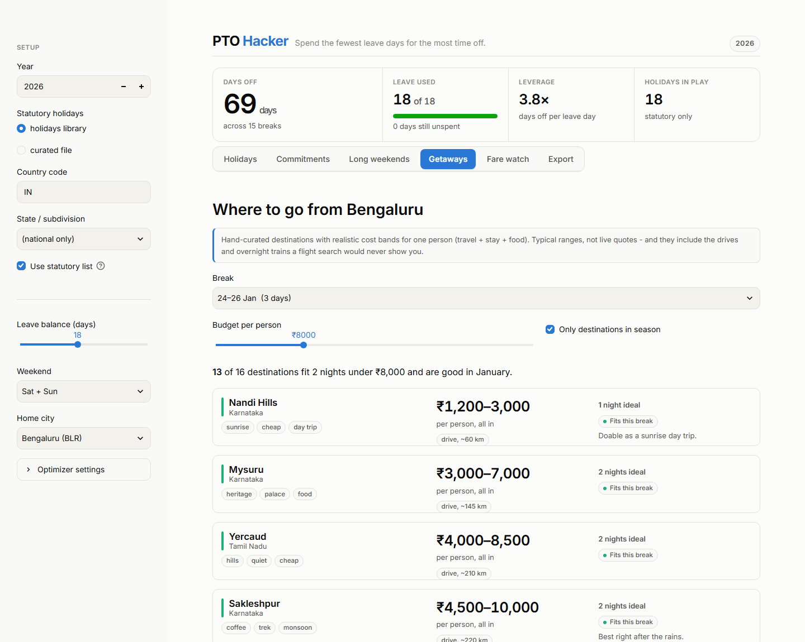
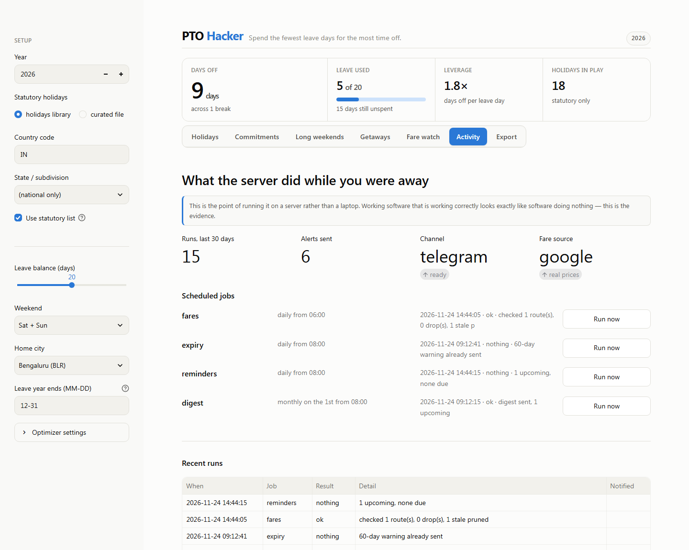

# PTO-Hacker

Spend the fewest leave days for the most time off.

Takes your company's holiday calendar and your leave balance, locks in the dates you've
already committed to, shows you every long weekend the rest of your balance can buy,
and matches each break to a getaway you can actually afford from your city.



## Quickstart

Python 3.10+. No API keys, no database server, no network calls at runtime.

```bash
git clone <this-repo> pto-hacker && cd pto-hacker
python -m venv .venv && source .venv/bin/activate   # Windows: .venv\Scripts\activate
pip install -r requirements.txt
streamlit run app.py
```

Open <http://localhost:8501>. A SQLite database appears at `output/pto.db` on first
run and keeps everything you enter.

Prefer containers, or deploying to your own VPS? See **[DEPLOY.md](DEPLOY.md)**.
On a bare Ubuntu server, `scripts/ubuntu_setup.sh` installs Docker and locks the
box down; then `docker compose --profile public up -d` serves it over HTTPS behind
a password.

### Verify it

```bash
python smoke_test.py                  # the planning engine, end to end
python store_test.py                  # persistence, against a throwaway DB
python daemon_test.py                 # scheduling + background jobs
python notify_test.py                 # notification channels, stubbed
bash scripts/clean_clone_check.sh     # simulates a cold clone in a fresh venv
```

On Windows prefix the Python ones with `PYTHONIOENCODING=utf-8`.

---

## The flow

It's a three-stage funnel, not a one-shot calculator. You stay in control at every step.

**Holidays** — Statutory list from the `holidays` library (200+ countries, state
subdivisions), plus *your company's* calendar. Add dates one at a time, paste a list, or
upload a CSV. Merge the two or plan against the company list alone.

**Commitments** — Dates you already know you're taking: a wedding, a visa
appointment, a trip already booked. Locked first, regardless of leverage. Everything
else plans around them.

**Long weekends** — Every break your *remaining* balance can buy, sorted by
leverage, length or date. Accept the ones you want; the rest recompute against what's
left. Or hit **Auto-fill best combination** and let the DP decide.

**Getaways** — For any break, destinations from your home city that fit the budget,
the number of nights, and the season.

Plus **Fare watch** (prices with history), **Activity** (what the server did while
you were away), and **Export** (`.ics` + `.csv`).

## It keeps working when you close the tab

The point of putting this on a server is that it does the checking for you.
`daemon.py` wakes every few minutes and runs whatever is due:

| Job | When | What it tells you |
|---|---|---|
| **expiry** | daily | *"You have 6 leave days that lapse on 31 Dec"* — with the best windows left |
| **reminders** | daily | *"Your 9-day break starts in 14 days — file the request"* |
| **fares** | daily | *"BLR→GOI dropped to ₹7,400, down 17%"* |
| **digest** | 1st of the month | What is planned, what it costs, what is unspent |

It only speaks when there is something to say, and every alert is fingerprinted so
the same news is never sent twice. Alerts go to Telegram (a bot token, no
deliverability problems) or to the log.

```bash
python daemon.py            # run forever -- this is what the server runs
python daemon.py --once     # run what is due now, then exit (for cron)
python daemon.py --job digest   # force one, useful for a demo
python daemon.py --list     # schedule and last run of each job
python daemon.py --telegram-chat-id   # find your chat id during setup
python daemon.py --test-notify        # prove the channel works
```

Configuration comes from the environment or a gitignored `.env` file; see
[DEPLOY.md](DEPLOY.md) for the Telegram setup.



### Example — India 2026, 18 days, one June commitment

```
68 days off for 18 leave days  (3.8x leverage)

  13 – 17 Jun     5 days off / 3 leave    <- committed: cousin's wedding
  26 Mar – 05 Apr 11 days off / 4 leave   bridges Ram Navami, Mahavir Jayanti, Good Friday
  23 – 31 May      9 days off / 4 leave   bridges Bakrid
  22 – 30 Aug      9 days off / 4 leave   bridges Independence Day
  17 – 20 Oct      4 days off / 1 leave   bridges Dussehra
  …plus 8 free long weekends costing nothing
```

Add your company's Christmas Eve holiday and a new 5-day break for 1 leave day appears
at the top of the rankings. That's the point of the company calendar.

---

## How the optimizer works

1. **Classify** every day as `work` / `weekend` / `holiday`. A holiday landing on a
   Saturday stays a weekend — it buys you nothing, and the app tells you how many you
   lost that way.
2. **Block** the days your commitments and accepted breaks already occupy.
3. **Enumerate** candidate breaks on what's left: take a run of workdays, extend outward
   across adjacent free days, dedupe by the extended span.
4. **Select** with an exact DP over `(day index, leave remaining)` — not a greedy pass,
   so it won't miss a combination a greedy picker would.

### Two knobs that matter

Maximising raw days off has a degenerate answer: buy 18 isolated Fridays, get 54 days
off at 3× leverage, and never take an actual holiday. Two settings fix that:

- **Only breaks that bridge a holiday** (default on) — discards isolated Fridays.
- **Prefer fewer, longer breaks** — scores a break as `span ** (1 + bias)`, so the same
  leave concentrated into a 9-day trip beats three long weekends.

Set the bias to 0 and untick the bridge filter to see the raw days-off optimum.

---

## Architecture

```
app.py          Streamlit UI (6 tabs, three-stage funnel)
ui.py           Design tokens (light + dark), CSS, and the components app.py draws
.streamlit/     Theme config: validated light & dark palettes, Inter, radii
Dockerfile      Container image; DB lives on a volume, never in the image
docker-compose.yml  App alone, or app + Caddy (--profile public)
Caddyfile       Automatic HTTPS and basic-auth for a public deployment
scripts/        Dev tooling: cold-clone check, screenshots, DOM dump
optimizer.py    Break enumeration, blocking, exact DP selection   <- the core
caldays.py      Year -> work/weekend/holiday day map
sources.py      Holiday backends: `holidays` lib, curated JSON, company list
getaways.py     Curated destinations by home city
flights.py      FareProvider interface + MockFareProvider
planning.py     Builds the plan from stored settings -- shared by UI and jobs
jobs.py         The four background jobs
daemon.py       Scheduler loop: runs what is due, logs it, sends alerts
notify.py       Notification channels (Telegram / console)
store.py        SQLite: settings, holidays, commitments, plan, fares, run log
watchlist.py    Fare watch over the store, with price history
exporters.py    .ics (RFC 5545) and .csv output
config.py       Defaults, all overridable in the sidebar
smoke_test.py   Headless end-to-end check
data/           Curated holiday JSON
output/         Watchlist store + logs (gitignored)
```

### State

Everything you enter is kept in SQLite — settings, your company's holiday list,
commitments, the accepted plan, and every fare check. Nothing lives in the browser
session, so a refresh, a reconnect, or a server restart loses nothing.

```bash
PTOHACKER_DB=/var/lib/pto-hacker/pto.db streamlit run app.py
```

The default is `output/pto.db`. Point `PTOHACKER_DB` at a mounted volume when you
deploy. The schema is created on first run, and an existing `output/watchlist.json`
from an earlier version is imported once and renamed.

WAL mode is on, so a background poller can write fares while the app reads — which
is what makes a scheduled fare watch possible on a server rather than only while a
browser tab is open.

### Your data

Everything you enter is stored in **one SQLite file on your own machine** —
`output/pto.db` by default, or wherever `PTOHACKER_DB` points. That file holds:

| Table | What it is |
|---|---|
| `settings` | Sidebar choices: year, leave balance, home city, weekend pattern, optimizer knobs |
| `company_holidays` | The dates and names you add or import |
| `commitments` | Your locked date ranges **and their labels** (e.g. "Cousin's wedding") |
| `accepted` | The breaks you accepted |
| `watch`, `watch_price` | Watched routes and every fare reading |

`output/` is gitignored, so none of it can be committed by accident.

**Nothing leaves the machine.** There are no outbound HTTP calls in the code:
holidays are computed offline by the `holidays` library, fares come from a local
mock, and Streamlit's usage telemetry is switched off in
`.streamlit/config.toml` (it defaults to *on*, so this is deliberate).

For the same reason there is no webfont import — loading Inter from a CDN would
have made every page view hit Google with the viewer's IP. The app uses Inter if
it is installed on the machine and falls back to the OS font otherwise. To get it
everywhere, self-host the woff2 files and declare them with `[[theme.fontFaces]]`.

If you deploy this publicly, note that the single basic-auth password is the only
thing protecting that database. There are no user accounts — see
[DEPLOY.md](DEPLOY.md).

### Light and dark

Both ship. The app follows your OS setting, and Settings -> Appearance overrides it.

Dark is not an automatic flip of the light theme: it's the same hues re-stepped for
the dark surface and re-validated against it, which is why the aqua that only *warns*
on contrast in light mode clears 3:1 in dark. Components read colours through
`ui.c("series_1")` rather than literals, so everything follows the active theme.

### Where the numbers come from — and how trustworthy they are

| Data | Source | Trust |
|---|---|---|
| Statutory holidays | [`vacanza/holidays`](https://github.com/vacanza/holidays) | Good; lunar dates still shift |
| Company holidays | You type them in | Yours |
| Curated holiday JSON | Hand-entered, `confidence` flagged | Verify the low-confidence ones |
| Getaway costs | Hand-researched typical bands | Realistic ranges, not quotes |
| Flight fares | `MockFareProvider` | **Synthetic.** Plausible, not real |

The getaway costs are deliberately *not* generated from a fare API. A made-up number
that looks precise is worse than an honest range — and a flight-price model misses the
thing that matters most in India, which is that most real weekend getaways are a drive
or an overnight train.

### Swapping in real flight prices

`flights.py` defines the seam. Implement one method:

```python
class AmadeusFareProvider(FareProvider):
    name = "amadeus"

    def quote(self, origin, destination, depart, ret=None) -> FareQuote:
        ...
```

then register it in `get_provider()`. Nothing in the optimizer, watchlist, or UI
changes.

---

## Prior art

The bridge-day formula is the same idea as
[famvacay](https://github.com/NemesisRE/famvacay) and
[holiday-optimizer](https://github.com/waqarkalim/holiday-optimizer) (the latter is an
archived, non-commercial-licensed snapshot — referenced for the algorithm only, not
forked). This implementation differs in four ways: exact DP instead of a greedy pass,
pre-committed dates the plan must work around, interactive accept-and-recompute rather
than a single generated answer, and a curated getaway layer.

---

## Verify before you book

```bash
python smoke_test.py
python store_test.py
```

Together they assert the plan never exceeds the budget, never overlaps, never
schedules leave on a non-working day, never clashes with a commitment, that every
getaway returned is within budget and long enough, and that nothing is lost across
a restart.

Asserts the plan never exceeds the budget, never overlaps, never schedules leave on a
non-working day, never clashes with a commitment, and that every getaway returned is
within budget and long enough.

**Then check the dates against your company's official holiday calendar.** Lunar and
Islamic holidays move and employers publish their own lists. The app flags
low-confidence dates, but it cannot know what your HR system says.
